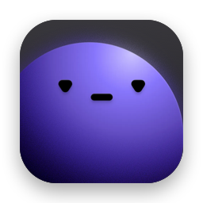

<div align="center">



# Danny

**The open-source video downloader for macOS.**<br>
Paste a link, watch it download, get a file. Native, light and private.

[](https://github.com/orpheus-ui/danny/releases)
[](https://github.com/orpheus-ui/danny/actions/workflows/ci.yml)
[](#requirements)
[](https://www.swift.org)
[](LICENSE)
[](https://github.com/orpheus-ui/danny/stargazers)

[**Download**](https://github.com/orpheus-ui/danny/releases) ·
[Features](#features) ·
[Install](#install) ·
[Build](#build) ·
[Roadmap](docs/roadmap.md) ·
[Contributing](CONTRIBUTING.md)


</div>

> [!NOTE]
> Danny is in **0.x preview**. It works every day, but expect rough edges and changes
> between releases. Bug reports are very welcome.

## Why Danny

- **Downloads from almost anywhere.** [yt-dlp](https://github.com/yt-dlp/yt-dlp)'s 1000+
  sites (YouTube, X, Instagram, TikTok, Vimeo…), and **Browser Capture** for the rest:
  browse to the page, play the video, pick the stream.
- **Light.** Nothing runs while Danny is idle. The progress bar is a Metal shader that
  draws only while something changes.
- **At home on macOS.** SwiftUI and Liquid Glass, a menu-bar item, Quick Look, Dock
  progress, notifications and keyboard control.
- **Private.** No accounts, no telemetry. Danny talks only to the sites you download
  from, and to GitHub to check for a newer yt-dlp (you can turn that off).
- **Open source.** MIT licensed, built in the open.

## Features

<table>
<tr>
<td width="50%" valign="top">

### Download
- **Any link, any way in:** ⌘V in the window, drag and drop a link or `.webloc`, the
  `+` menu, or a copied link Danny offers when you switch back
- **Browser Capture:** a built-in browser that detects `<video>` elements, HLS (`m3u8`)
  and DASH (`mpd`) streams, with an ad and tracker blocker
- **Sign in to sites:** downloads that need an account work as you, signed in on the
  site's own page
- **Quality and format:** best, a resolution cap or audio only, or **Ask** to pick
  from the formats on the card

</td>
<td width="50%" valign="top">

### Stay in control
- **Smart queue:** concurrent downloads, pause and resume (Pause All, ⌥⌘P), retry,
  cancel; a paused download survives a quit
- **Speed modes:** Full Speed, Balanced or Background, your own limits, or Wi-Fi only
- **Clear failures:** a short reason and the one action that can help
- **Already downloaded?** Replace it, keep both, or show the one you have

</td>
</tr>
<tr>
<td width="50%" valign="top">

### Organize
- **A folder per site** and filename templates, with a live preview
- **Grouped list:** active first, then Today and Earlier
- **Search** filters your downloads; paste a link into it to download
- **History** that survives relaunches, with Clear Cache for the web data

</td>
<td width="50%" valign="top">

### Everywhere on your Mac
- **Menu-bar item** with progress, paste to download and recent files
- **Dock progress** and a notification when a download finishes
- **Quick Look** with Space, double-click to open, hover for Reveal and Copy Link
- **Keyboard:** arrows select, ⌫ removes, ⌘R retries, Return opens

</td>
</tr>
</table>

<div align="center">

</div>

## Install

1. Download the latest DMG from [**Releases**](https://github.com/orpheus-ui/danny/releases).
2. Open it and drag **Danny** to Applications.

yt-dlp, ffmpeg and QuickJS-ng come inside the app, and Danny keeps yt-dlp current on
its own.

> [!IMPORTANT]
> 0.x builds aren't notarized yet, so macOS blocks the first launch. Open Danny once,
> then go to **System Settings → Privacy & Security → Open Anyway**
> ([details](docs/releasing.md#installing-an-unsigned-build)).

Homebrew is on the way: `brew install --cask orpheus-ui/tap/danny`.

## Requirements

| | |
|---|---|
| **macOS** | 26 Tahoe or newer (Danny is built on Liquid Glass) |
| **Bundled** | [yt-dlp](https://github.com/yt-dlp/yt-dlp), [ffmpeg](https://ffmpeg.org) (LGPL build), [QuickJS-ng](https://github.com/quickjs-ng/quickjs) |
| **To build** | Xcode 26 with its Metal Toolchain (`xcodebuild -downloadComponent MetalToolchain`) |

## Usage

| Do | How |
|---|---|
| Download a link | **⌘V** in the window, drag it in, or **⌘⇧V** from anywhere in Danny |
| Type a URL | **⌘N** or the **`+`** button |
| Grab a stream yt-dlp can't | **Browser Capture**: the globe button or **⌘⇧B**, then play the video and pick it from the sidebar |
| Download as yourself | **Settings › Sources**: sign in to YouTube, Instagram, X, Facebook or any site you add |
| Open a finished video | Double-click, Return, or Space for Quick Look |
| Pause everything | **⌥⌘P** |
| Settings | **⌘,** (General, Downloads, Quality, Network, Sources, Engine & Updates) |

## Build

```bash
make bootstrap   # tools (Homebrew), git hooks, asset catalog, Xcode project
make run         # build and launch
```

`make help` lists every command, and `make check` runs lint and tests. Once the project
is generated, `open Danny.xcodeproj` works too.

<details>
<summary><b>Where Danny finds yt-dlp and ffmpeg</b></summary>

1. **Kept current** (yt-dlp only): each time Danny opens, it fetches yt-dlp's latest
   release, checks it against the published checksums and keeps it in
   `~/Library/Application Support/Danny/bin`. Turn it off in Settings › Engine & Updates.
2. **Bundled** in `Danny.app/Contents/Resources/bin`. Run `./scripts/fetch-dependencies.sh`
   before building to include them (the first run builds ffmpeg from source, which takes
   a few minutes).
3. **Homebrew**: `brew install yt-dlp ffmpeg` (`/opt/homebrew/bin`, `/usr/local/bin`)
4. Anything on your `PATH`

</details>

<details>
<summary><b>Licenses of bundled tools</b></summary>

`yt-dlp` is public domain (Unlicense). QuickJS-ng (`qjs`) is MIT licensed. `ffmpeg` and
`ffprobe` are an LGPL build made from source by `scripts/build-ffmpeg.sh`; their license
texts ship in `Danny.app/Contents/Resources/bin/licenses`, and each GitHub Release carries
the exact source archives. The title font, Space Grotesk, is bundled under the SIL Open
Font License; its license text ships in `Danny.app/Contents/Resources/Fonts`.

</details>

## Roadmap

| Release | Headline |
|---|---|
| **0.x preview** | Everything above |
| **1.0** | Follow a channel · audio mode · SponsorBlock and subtitles · send to Danny from anywhere · signed and auto-updating |
| **1.1** | Torrents you can watch while they download |
| **2.0** | Plugins: any site, any file type, written in any language |

The full plan is in [docs/roadmap.md](docs/roadmap.md).

## Contributing

Bug fixes and design polish are welcome, and plugins from 2.0. Start with
[CONTRIBUTING.md](CONTRIBUTING.md). Found a security issue? See [SECURITY.md](SECURITY.md).

## Legal

Danny is a download manager. It doesn't host, index or bypass DRM for any content. You
are responsible for respecting copyright and each site's terms of service. Danny isn't
affiliated with YouTube, X, Instagram or Downie, which inspired it.

## License

[MIT](LICENSE). Copyright © 2026 Danny contributors.
