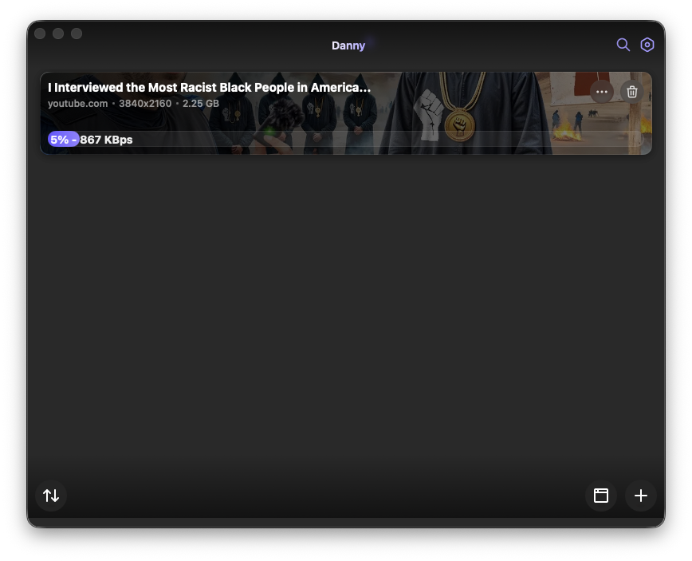
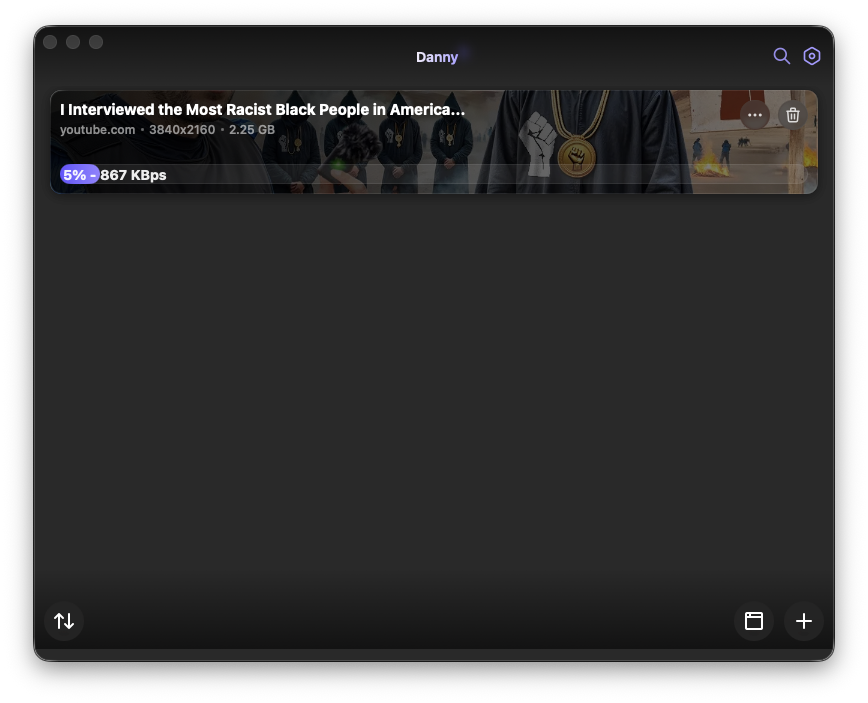

# Danny — video downloader for macOS

Danny is an open-source video downloader for macOS, inspired by [Downie](https://software.charliemonroe.net/downie/). Paste a link from YouTube, X, Instagram, or thousands of other sites, watch the live progress, done. For stubborn sites, Danny's built-in **Browser Capture** watches network traffic while you browse and hands you every video file and HLS stream it detects.



## Features

- **Downloads from anywhere** — powered by [yt-dlp](https://github.com/yt-dlp/yt-dlp): YouTube, X/Twitter, Instagram, TikTok, Vimeo, and 1000+ extractors
- **Browser Capture** — a built-in browser that sniffs network traffic, `<video>` elements, HLS (`m3u8`) and DASH (`mpd`) manifests while you browse. Every detected stream appears in the sidebar with a one-click **+** to download
- **Live progress** — percentage and real-time speed on a liquid-glass progress bar


- **Smart queue** — configurable concurrent downloads, retry, cancel, per-item actions
- **Clipboard-friendly** — paste from the `+` menu, or enable clipboard watching in Settings
- **Persistent history** — the queue survives relaunches
- **Native & private** — SwiftUI + Liquid Glass, no telemetry, no accounts, nothing leaves your machine except the video request itself

## Requirements

- macOS 14 Sonoma or newer (Liquid Glass effects on macOS 26+)
- [yt-dlp](https://github.com/yt-dlp/yt-dlp) and [ffmpeg](https://ffmpeg.org) for downloading and merging streams
- Xcode 26 to build from source

## Build

```bash
brew install xcodegen          # generates the Xcode project
./scripts/build-assets.sh      # builds the asset catalog
xcodegen generate
open Danny.xcodeproj           # ⌘R to run
```

### Dependencies

Danny looks for `yt-dlp` and `ffmpeg` in this order:

1. **Bundled** in `Danny.app/Contents/Resources/bin` — run `./scripts/fetch-dependencies.sh` before building to include them
2. **Homebrew**: `brew install yt-dlp ffmpeg` (`/opt/homebrew/bin`, `/usr/local/bin`)
3. Anything on your `PATH`

> `yt-dlp` is public domain (Unlicense). `ffmpeg` is LGPL — review its terms before redistributing bundled builds.

## Usage

- **`+`** — paste a link from the clipboard or type a URL
- **⌘⇧V** — paste and download from anywhere
- **Browser Capture** (globe icon or ⌘⇧B) — for sites where extraction fails. Browse, play the video, then pick the stream from the sidebar. The first launch asks for your consent
- **⌘N** — enter a URL manually · **⌘, ** — settings (save folder, concurrency, clipboard watching)

## Legal

Danny is a download manager — it doesn't host, index, or bypass DRM for any content. You are responsible for respecting copyright and each site's terms of service. Not affiliated with YouTube, X, Instagram, or Downie.

## License

[MIT](LICENSE) — copyright © 2026 Danny contributors
